# Práctica 1.10: Arquitectura LAMP con balanceador de carga y alta disponibilidad

## Introducción y Objetivos

El objetivo de esta práctica es automatizar el despliegue de un sitio web **WordPress** sobre una **arquitectura LAMP en tres niveles con balanceo de carga**, repartiendo los servicios en **cuatro máquinas independientes**:

* **Balanceador de carga**: servidor **Nginx** que recibe todo el tráfico de Internet, emite el certificado SSL/TLS con **Let's Encrypt** y reparte las peticiones entre los dos frontends.

* **Frontend 1 y Frontend 2**: servidores web con **Apache** y **PHP**. Ambos sirven el mismo WordPress, instalado mediante **WP-CLI**.

* **Backend**: servidor de base de datos con **MySQL**. No es accesible desde Internet; únicamente recibe conexiones de los frontends.

Esta separación mejora la seguridad (ni los frontends ni la base de datos quedan expuestos directamente a Internet), la disponibilidad (si un frontend cae, el otro sigue atendiendo) y el rendimiento (la carga se reparte entre varios servidores).

## Arquitectura

```
                       Internet
                          │
                   80 (HTTP) / 443 (HTTPS)
                          │
               ┌──────────▼───────────┐
               │    LOAD BALANCER     │
               │  Nginx + Certbot/SSL │
               └─────┬──────────┬─────┘
                     │ 80       │ 80
          ┌──────────▼───┐  ┌───▼──────────┐
          │  FRONTEND 1  │  │  FRONTEND 2  │
          │ Apache + PHP │  │ Apache + PHP │
          │  WordPress   │  │  WordPress   │
          └──────┬───────┘  └───────┬──────┘
                 │ 3306 (MySQL)     │ 3306 (MySQL)
                 └────────┬─────────┘
                 ┌────────▼─────────┐
                 │     BACKEND      │
                 │   MySQL Server   │
                 └──────────────────┘
```

## Requisitos Previos

Antes de ejecutar los scripts de automatización, se debe cumplir lo siguiente:

1. **Cuatro máquinas** con un sistema operativo basado en **Ubuntu** y acceso a privilegios de superusuario (`sudo`): balanceador, frontend 1, frontend 2 y backend.

2. Un nombre de **dominio apuntando a la dirección IP pública del balanceador**.

3. **Cortafuegos / grupos de seguridad** configurados así:

   | Máquina           | Puerto       | Origen                          |
   |-------------------|--------------|---------------------------------|
   | Load Balancer     | 80 (HTTP)    | Cualquiera (`0.0.0.0/0`)        |
   | Load Balancer     | 443 (HTTPS)  | Cualquiera (`0.0.0.0/0`)        |
   | Frontend 1 y 2    | 80 (HTTP)    | **Solo la IP del balanceador**  |
   | Backend           | 3306 (MySQL) | **Solo las IPs de los frontends** |

4. **Conectividad entre las máquinas**: el balanceador debe alcanzar a ambos frontends por el puerto 80 y los frontends deben alcanzar al backend por el puerto 3306.

5. El repositorio clonado en **todas las máquinas**.

## Estructura del Repositorio

La arquitectura del proyecto está organizada de forma modular separando configuraciones, scripts de despliegue y archivos estáticos. Los scripts se dividen según la máquina en la que deben ejecutarse (`_frontend` / `_backend` / `_load-balancer`):

```
.
├── conf/
│   ├── 000-default.conf                    # VirtualHost base para peticiones HTTP (frontends)
│   ├── load-balancer.conf.template         # Plantilla de Nginx para el balanceador
│   └── virtualhost.conf.template           # Plantilla de VirtualHost de Apache
├── .gitignore                              # Exclusión de archivos sensibles (.env)
├── .htaccess/
│   └── .htaccess                           # Reglas de reescritura para permalinks
├── php/
│   └── index.php                           # Comprobación del motor PHP (phpinfo)
├── README.md                               # Documentación técnica del proyecto
├── screenshots/                            # Evidencias visuales del funcionamiento
│   ├── certbot_load-balancer.png
│   ├── certificado.png
│   ├── deploy_backed.png
│   ├── deploy_frontend-1.png
│   ├── deploy_frontend-2.png
│   ├── edit_php_frontend.png
│   ├── install_backend.png
│   ├── install_frontend-1.png
│   ├── install_frontend-2.png
│   ├── install_load-balancer.png
│   ├── load-balancer_frontend_1.png
│   └── load-balancer_frontend_2.png
└── scripts/
    ├── .env.example                        # Plantilla de variables de entorno
    ├── install_lamp_backend.sh             # [BACKEND]:       Instalación de MySQL
    ├── install_lamp_frontend.sh            # [FRONTEND 1 y 2]: Instalación de Apache + PHP
    ├── deploy_wordpress-backend.sh         # [BACKEND]:       Creación de la BD y el usuario de WordPress
    ├── deploy_wordpress-frontend.sh        # [FRONTEND 1 y 2]: Despliegue automatizado con WP-CLI
    ├── install_load-balancer.sh            # [LOAD BALANCER]: Instalación y configuración de Nginx
    └── setup_letsencrypt_certificate.sh    # [LOAD BALANCER]: Certificado SSL con Certbot
```

## Resumen del Orden de Ejecución

El orden es importante: la base de datos debe existir **antes** de instalar WordPress en los frontends, y los frontends deben estar funcionando **antes** de configurar el balanceador.

| Paso | Máquina          | Script                             | Qué hace                                         |
|------|------------------|------------------------------------|--------------------------------------------------|
| 0    | Todas            | `.env`                             | Configuración de variables de entorno            |
| 1    | Backend          | `install_lamp_backend.sh`          | Instala MySQL y lo expone a la red               |
| 2    | Backend          | `deploy_wordpress-backend.sh`      | Crea la base de datos y el usuario               |
| 3    | Frontend 1 y 2   | `install_lamp_frontend.sh`         | Instala Apache, PHP y módulos                    |
| 4    | Frontend 1 y 2   | `deploy_wordpress-frontend.sh`     | Instala WordPress con WP-CLI                     |
| 5    | Load Balancer    | `install_load-balancer.sh`         | Instala Nginx y configura el reparto de carga    |
| 6    | Load Balancer    | `setup_letsencrypt_certificate.sh` | Solicita el certificado SSL con Certbot          |

## Guía de Despliegue Paso a Paso

### Paso 0: Configuración de Variables de Entorno (en todas las máquinas)

Antes de lanzar la automatización, es imprescindible crear el archivo `.env` en la carpeta `scripts/` copiando la plantilla `.env.example`. Este archivo centraliza la configuración sensible para que los scripts no contengan contraseñas en duro. Está incluido en el `.gitignore`, por lo que nunca se sube al repositorio.

```
cd scripts/
cp .env.example .env
nano .env
```

Define los valores reales dentro de `.env`:

* `LETS_ENCRYPT_DOMAIN`: Tu dominio configurado (ej. `mi-dominio.com`).

* `LETS_ENCRYPT_EMAIL`: Tu correo de contacto para Let's Encrypt.

* `WORDPRESS_DB_NAME`, `WORDPRESS_DB_USER`, `WORDPRESS_DB_PASSWORD`: Credenciales de la base de datos de WordPress.

* `WORDPRESS_DB_HOST`: **IP privada del backend**. La utilizan los frontends para conectarse a MySQL.

* `IP_CLIENTE_MYSQL`: **IP desde la que se permite la conexión a MySQL** (la de los frontends). La utiliza el backend para crear el usuario de MySQL y limitarlo a ese origen.

* `WORDPRESS_TITLE`: Título del sitio WordPress.

* `WORDPRESS_ADMIN_USER`, `WORDPRESS_ADMIN_PASSWORD`, `WORDPRESS_ADMIN_EMAIL`: Credenciales del usuario administrador de WordPress.

* `NOMBRE_SECRETO`: Slug o ruta personalizada para la URL secreta de login (ej. `secreto`).

* `IP_FRONTEND_1`, `IP_FRONTEND_2`: **IPs privadas de los frontends**. Las utiliza el balanceador para repartir el tráfico entre ellos.

### Paso 1: Instalación de MySQL en el Backend (`scripts/install_lamp_backend.sh`)

Este script aprovisiona el servidor de base de datos: instala MySQL Server y lo configura para aceptar conexiones desde otras máquinas.

Por defecto, MySQL solo escucha en `127.0.0.1` (localhost), por lo que rechazaría cualquier conexión procedente de los frontends. El script modifica `mysqld.cnf` para que escuche en todas las interfaces. Aunque MySQL quede escuchando en todas las interfaces, la seguridad se mantiene en dos capas: el **cortafuegos** (puerto 3306 abierto solo para los frontends) y el **usuario de MySQL**, que se crea ligado a la IP de origen permitida (Paso 2).

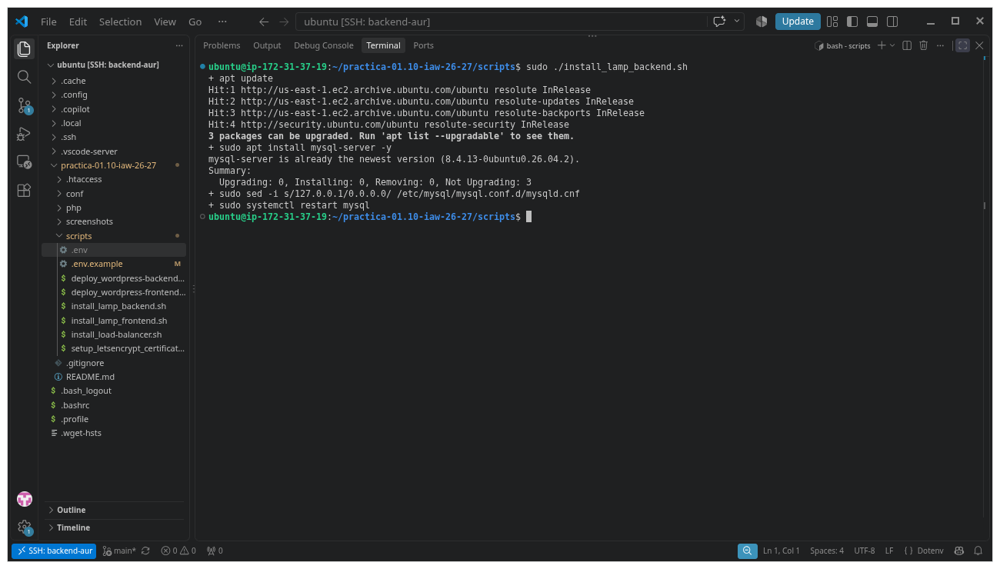

### Paso 2: Creación de la Base de Datos en el Backend (`scripts/deploy_wordpress-backend.sh`)

Este script prepara en MySQL todo lo que WordPress necesita: la base de datos y un usuario dedicado con permisos únicamente sobre ella.

El usuario se crea como `usuario@IP_CLIENTE_MYSQL`, es decir, **solo puede conectarse desde la IP permitida**. Además, `DROP ... IF EXISTS` hace el script **idempotente**: puede relanzarse tantas veces como se necesite y siempre dejará el entorno limpio. Los privilegios se limitan a `$WORDPRESS_DB_NAME.*`, siguiendo el principio de mínimo privilegio.

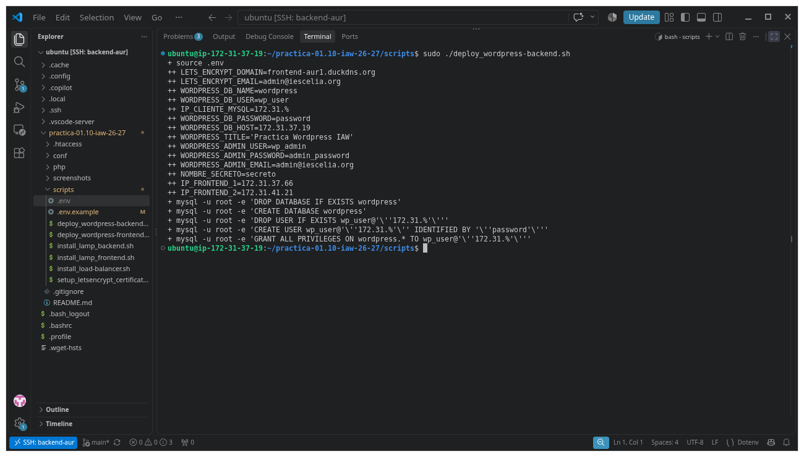

### Paso 3: Instalación de Apache y PHP en los Frontends (`scripts/install_lamp_frontend.sh`)

Este script se ejecuta **en ambos frontends**. Instala Apache2, PHP con la extensión necesaria para MySQL, habilita `mod_rewrite` (necesario para los permalinks de WordPress) y copia el VirtualHost inicial (`conf/000-default.conf`) y el `index.php` de comprobación.

Se instala `php-mysql` porque es la extensión que permite a PHP conectarse al servidor MySQL **remoto** del backend; en estas máquinas **no** se instala MySQL Server.

Al terminar, puede comprobarse que PHP funciona accediendo a `http://IP_DEL_FRONTEND/index.php`, que muestra la salida de `phpinfo()`.

**Frontend 1**

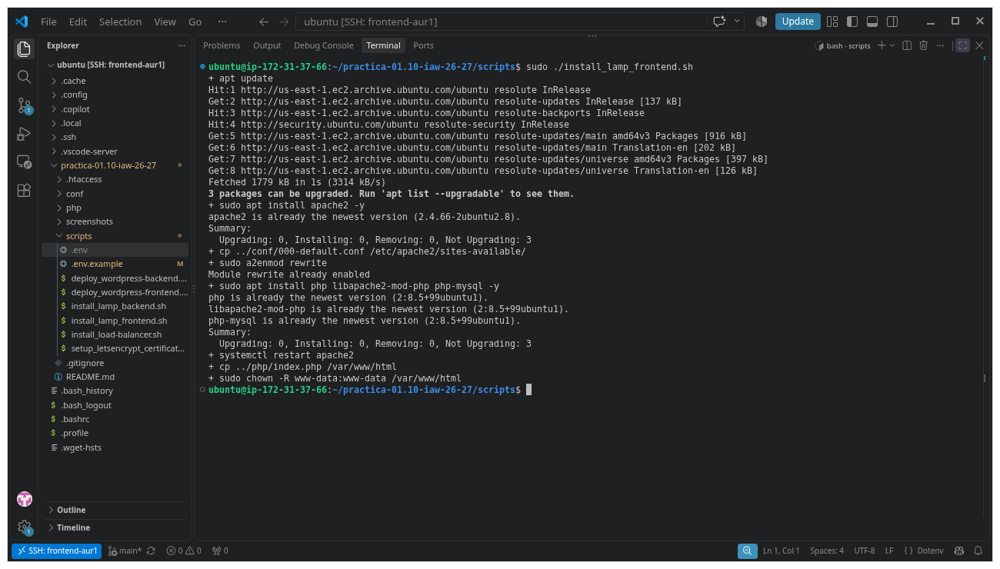

**Frontend 2**

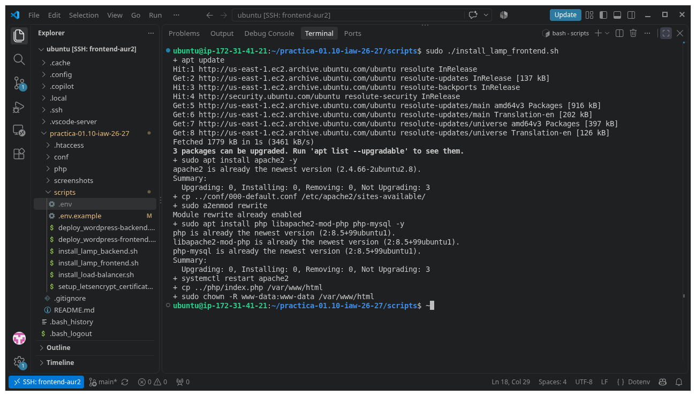

### Paso 4: Despliegue de WordPress con WP-CLI en los Frontends (`scripts/deploy_wordpress-frontend.sh`)

Este script se ejecuta **en ambos frontends**. En lugar de instalar WordPress descargando un archivo zip y rellenando formularios web, usamos **WP-CLI** para automatizar la descarga del núcleo, la creación del `wp-config.php` apuntando al backend, la instalación, la aplicación de temas y plugins y la personalización de la URL de administración.

La clave está en `wp config create`: el parámetro `--dbhost=$WORDPRESS_DB_HOST` apunta a la IP del backend en lugar de `localhost`, de modo que **ambos frontends comparten la misma base de datos** y sirven exactamente el mismo contenido. Por eso es obligatorio haber ejecutado antes el Paso 2.

Por último, se copia el archivo `.htaccess` versionado en el repositorio, que contiene las reglas de reescritura estándar de WordPress:

```
# BEGIN WordPress
<IfModule mod_rewrite.c>
RewriteEngine On
RewriteBase /
RewriteRule ^index\.php$ - [L]
RewriteCond %{REQUEST_FILENAME} !-f
RewriteCond %{REQUEST_FILENAME} !-d
RewriteRule . /index.php [L]
</IfModule>
# END WordPress
```

**Frontend 1**

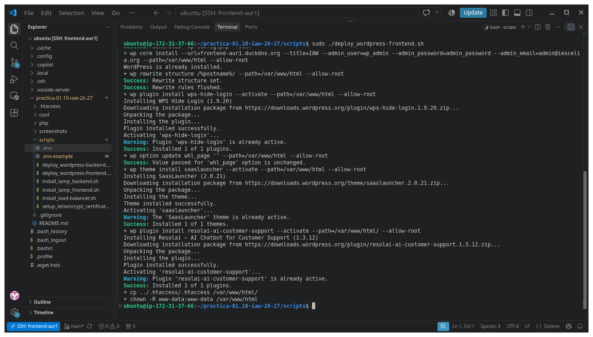

**Frontend 2**

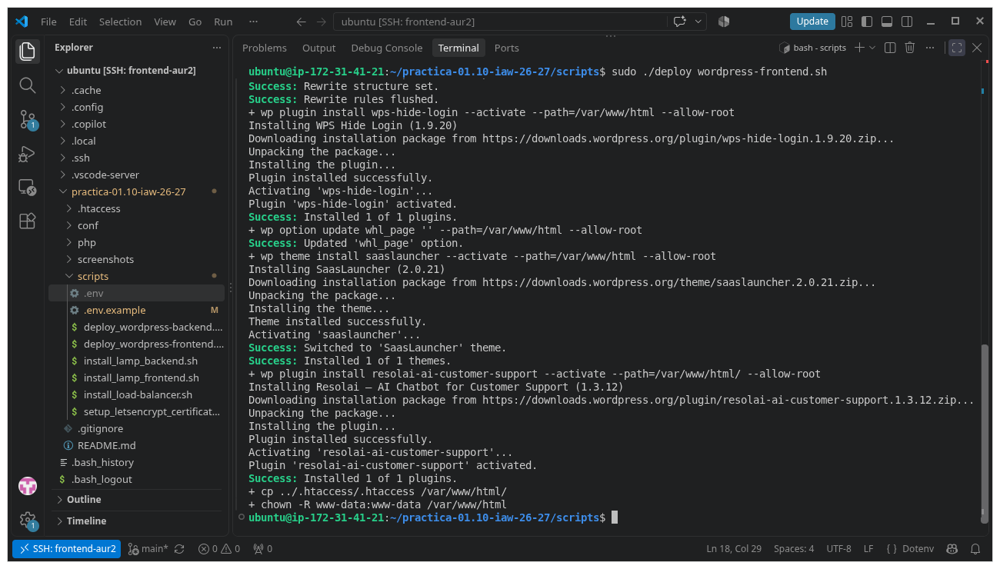

La plantilla `conf/virtualhost.conf.template` utilizada por los frontends es la siguiente:

```
<VirtualHost *:80>
  #ServerName ${LETS_ENCRYPT_DOMAIN}
  ServerAdmin ${LETS_ENCRYPT_EMAIL}
  DocumentRoot /var/www/html/
  DirectoryIndex index.php index.html

  <Directory /var/www/html>
    AllowOverride All
  </Directory>

  ErrorLog ${APACHE_LOG_DIR}/error.log
  CustomLog ${APACHE_LOG_DIR}/access.log combined
</VirtualHost>
```

La directiva `AllowOverride All` permite que Apache lea el `.htaccess` de WordPress (imprescindible para los permalinks).

### Paso 5: Instalación del Balanceador de Carga (`scripts/install_load-balancer.sh`)

Este script aprovisiona el balanceador: instala **Nginx** y genera su configuración a partir de la plantilla `conf/load-balancer.conf.template`, sustituyendo las variables `IP_FRONTEND_1` e `IP_FRONTEND_2` del `.env`. De este modo, Nginx actúa como **proxy inverso** y reparte las peticiones entrantes entre los dos frontends.

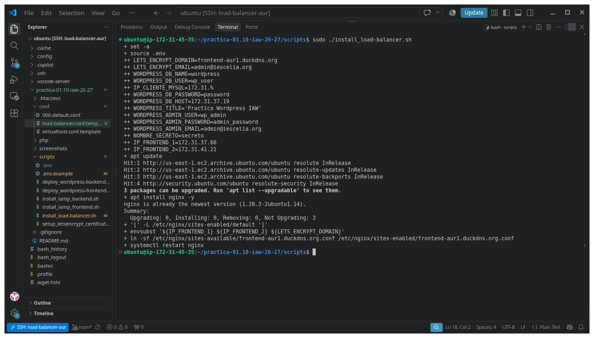

### Paso 6: Emisión del Certificado SSL en el Balanceador (`scripts/setup_letsencrypt_certificate.sh`)

Con el balanceador ya funcionando, solicitamos a la entidad emisora **Let's Encrypt** el certificado seguro a través del cliente oficial **Certbot**. Como el punto de entrada de la arquitectura es el balanceador, el certificado se instala **únicamente en esta máquina**; los frontends solo reciben tráfico HTTP interno desde él.

```
#!/bin/bash
set -exu

set -a
source .env

#Realizamos la instalación y actualización de snapd
sudo snap install core
sudo snap refresh core

#Eliminamos si existe la versión anterior de Certbot
sudo apt remove certbot -y

#Instalamos el cliente de Certbot
sudo snap install --classic certbot

#Creamos un alias para el comando certbot
sudo ln -fs /snap/bin/certbot /usr/bin/certbot

#Ejecutamos el comando para obtener el certificado SSL de Let's Encrypt
sudo certbot --nginx -m $LETS_ENCRYPT_EMAIL --agree-tos --no-eff-email -d $LETS_ENCRYPT_DOMAIN --non-interactive
```

Se utiliza el plugin `--nginx` de Certbot, que modifica automáticamente la configuración de Nginx para activar HTTPS y redirigir el tráfico HTTP. El parámetro `--non-interactive` permite realizar la emisión en segundo plano sin confirmaciones manuales.

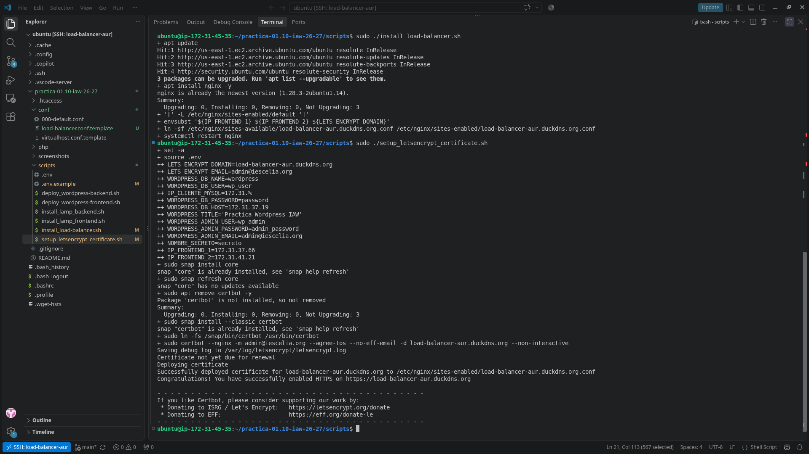

## Verificación y Evidencias de Funcionamiento

A continuación se detallan las verificaciones realizadas para asegurar que el despliegue automático ha concluido con éxito.

### 1. Ejecución Correcta de los Scripts

Las capturas de cada paso (incluidas en la guía anterior) muestran la ejecución de los scripts en cada máquina sin errores de sintaxis ni fallos de conexión entre el balanceador, los frontends y el backend.

### 2. Validación del Balanceo de Carga

Para comprobar que el balanceador reparte correctamente el tráfico, se ha editado temporalmente el archivo `/var/www/html/index.php` de **cada frontend** para que muestre un texto distinto que los identifique:

```php
<?php
echo "Frontend 2"
?>
```

(En el frontend 1 se escribe `Frontend 1`.)

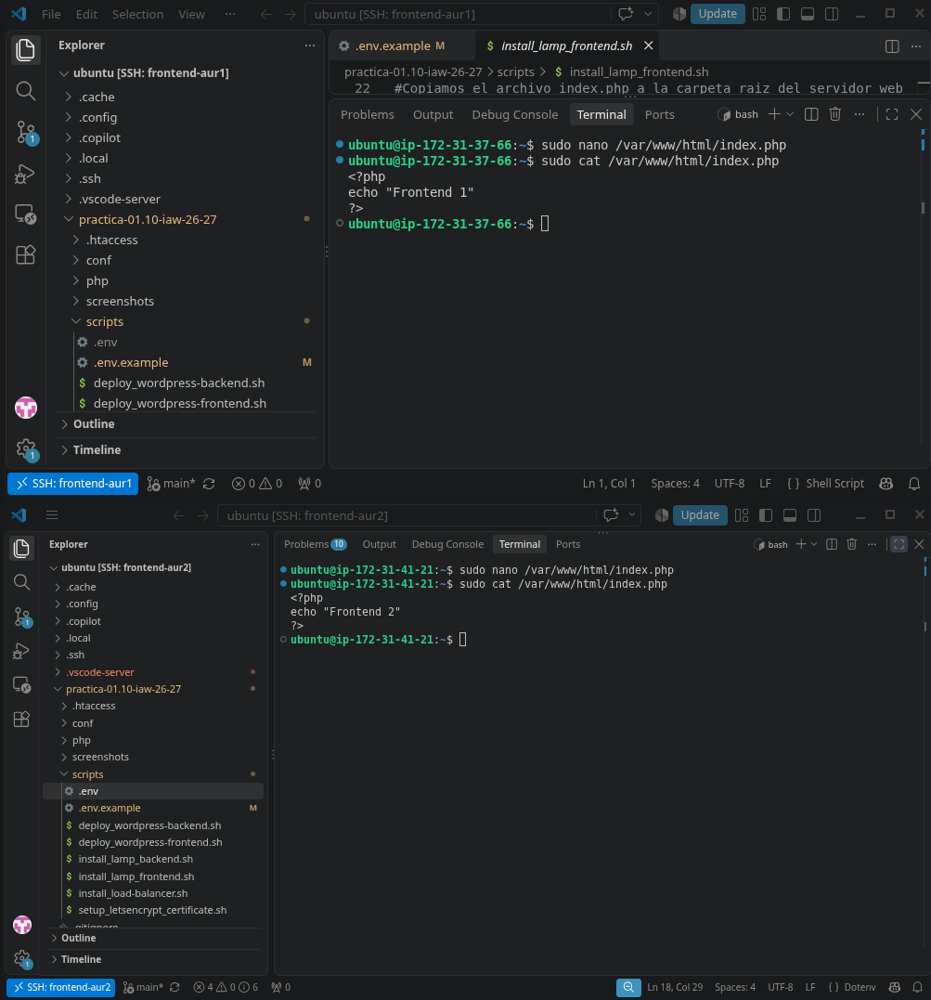

Al acceder a la web a través del balanceador, se obtiene la respuesta de uno u otro frontend:

* Acceso al balanceador atendido por el **Frontend 1**:

  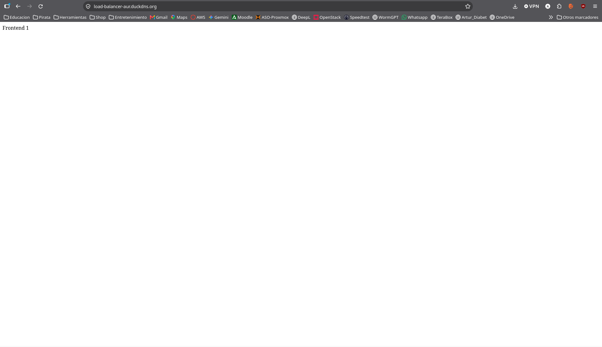

* Acceso al balanceador atendido por el **Frontend 2**:

  

Esto demuestra que las peticiones se distribuyen entre ambos servidores y que ambos responden correctamente.

### 3. Validación de la Conexión Segura HTTPS/SSL

Inspección del certificado SSL desde la barra del navegador comprobando la entidad emisora.

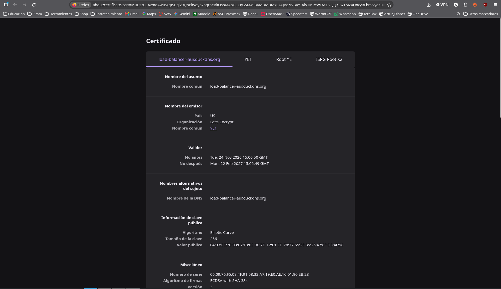

* El protocolo HTTPS funciona correctamente, la conexión está cifrada entre el cliente y el balanceador y el certificado ha sido emitido por una CA válida.